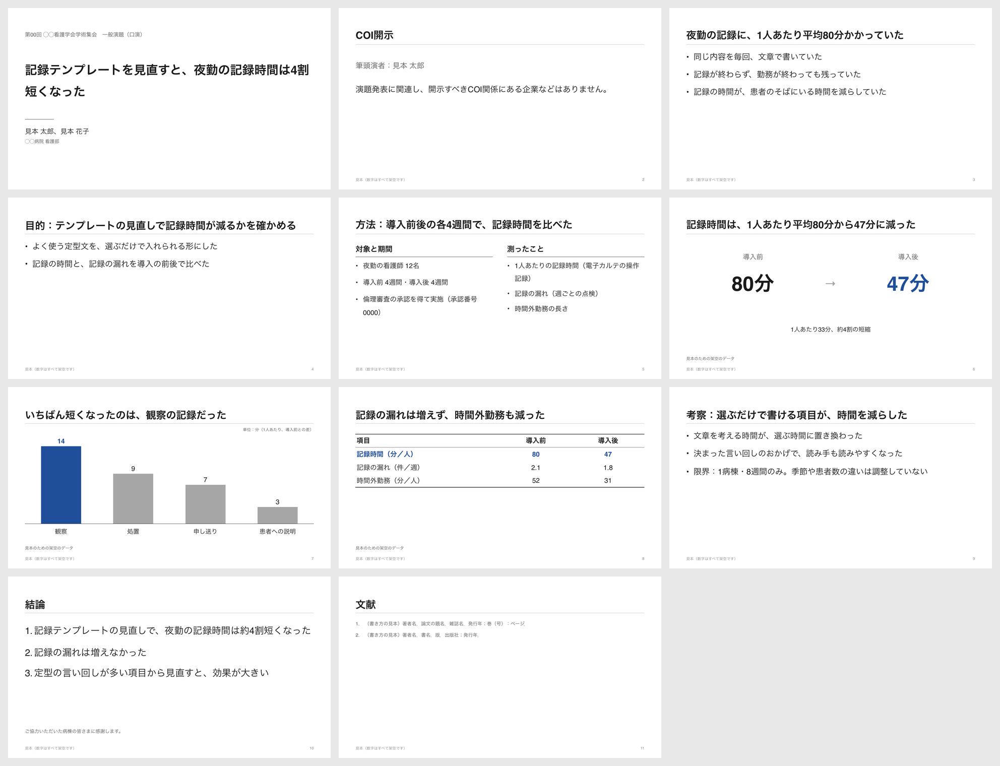

# gakkai-slide

抄録や原稿から、**学会発表や勉強会でそのまま使えるスライド（.pptx）** を作る Claude 用のスキルです。

白い背景に、色は黒とグレーと基調色の1色だけ。1枚に1つの結論を大きく見せる、落ち着いたスライドにします。



> 上の見本の数字・病院名・人名はすべて架空です。中身は [examples/sample.json](examples/sample.json)、できあがりは [examples/sample.pptx](examples/sample.pptx)（[PDF](examples/sample.pdf)）にあります。

## できること

- 学会（口演）の流れで組み立てる：表紙 → COI開示 → 背景 → 目的 → 方法 → 結果 → 考察 → 結論
- 勉強会・院内研修の流れにも対応：表紙 → 今日の結論 → 本題 → まとめ
- タイトルは「結論を1文」で書く（「結果」「〜について」にしない）
- 本文は7行まで・24ポイント以上。背景は白で、グラデーション・影・角丸の囲み・色の帯・絵文字は使わない
- 色は、いちばん見てほしい数字・棒・行にだけ付ける。赤と緑の違いで意味を伝えない
- 表は3本線、棒グラフは見せたい1本だけに色
- 読み原稿をノートに入れ、字数から発表時間を見積もる（1分300字）
- 作るときに、タイトルの長さ・本文の行数・COI・出典・絵文字・持ち時間を自動で点検する
- 16:9 と 4:3 のどちらでも作れる

棒グラフは図形で描くので、PowerPoint・Keynote・Googleスライドのどれで開いても同じ見た目になります。

## インストール

### Claude Code（プラグインとして）

Claude Code の中で、次の2つを順に実行します。

```
/plugin marketplace add syunkuro123/gakkai-slide
/plugin install gakkai-slide@gakkai-slide
```

### Claude Code（スキルだけを置く）

```
git clone https://github.com/syunkuro123/gakkai-slide.git
cp -r gakkai-slide/skills/gakkai-slide ~/.claude/skills/
cd ~/.claude/skills/gakkai-slide/scripts && npm install
```

`npm install` には Node.js が必要です。入っていないときは、Claude が同じ決まりでほかの方法（python-pptx など）を使って作ります。

### Claude のアプリ（claude.ai・デスクトップ）

1. `skills/gakkai-slide` フォルダを ZIP にまとめます
2. Claude の設定からスキルの画面を開き、ZIP をアップロードします

## 使い方

抄録や原稿を渡して、次のように頼みます。

```
この抄録から、学会の口演スライドを作って。持ち時間は7分
```

```
この原稿で、院内勉強会のスライドを作って。20分、4:3で
```

```
結果の数字はこの表のとおり。基調色は深緑（#2E6B4F）で
```

できあがると、ファイル・枚数・見積もった発表時間・点検で気になった所・要確認の一覧が報告されます。

### 自分で作る（JSON から）

```
cd skills/gakkai-slide/scripts
npm install
node build.mjs ../../../examples/sample.json -o my-slide.pptx
```

`--check` を付けると、ファイルを作らずに点検だけを行います。

## フォント

既定は **BIZ UDPゴシック**（読みやすさを考えて作られたフォント）です。Windows 10 以降には最初から入っています。Mac では代わりにヒラギノで表示されます（見本の画像は Mac で書き出したものです）。

Mac でも同じ文字にしたいときは、JSON の `meta.font` を `BIZ UDGothic` にしてください。

## 発表前に確かめること

このスキルは見た目を整え、点検を手伝うものです。次の点は、発表する人が必ず確かめてください。

- 学会が指定する COI 開示の様式
- 個人が特定される情報が入っていないか（氏名・顔・ID・日付など）
- 抄録とスライドの数字が一致しているか
- 倫理審査の承認と番号

## 構成

```
.claude-plugin/
  plugin.json            プラグインの定義
  marketplace.json       マーケットプレイスの定義
skills/gakkai-slide/
  SKILL.md               スキル本体（Claude が読む手順と決まり）
  scripts/build.mjs      JSON から .pptx を作り、点検する
  scripts/package.json
examples/                見本（JSON・pptx・PDF）
docs/preview/            見本の画像
```

## ライセンス

MIT License（自由に使い、直し、配ってかまいません）

作った人：すんなりわかる
